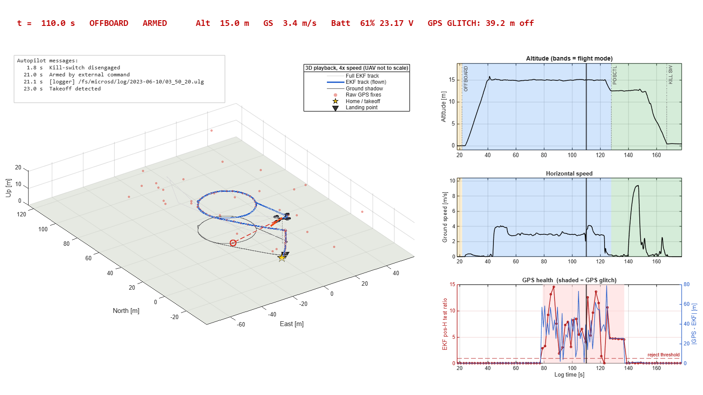
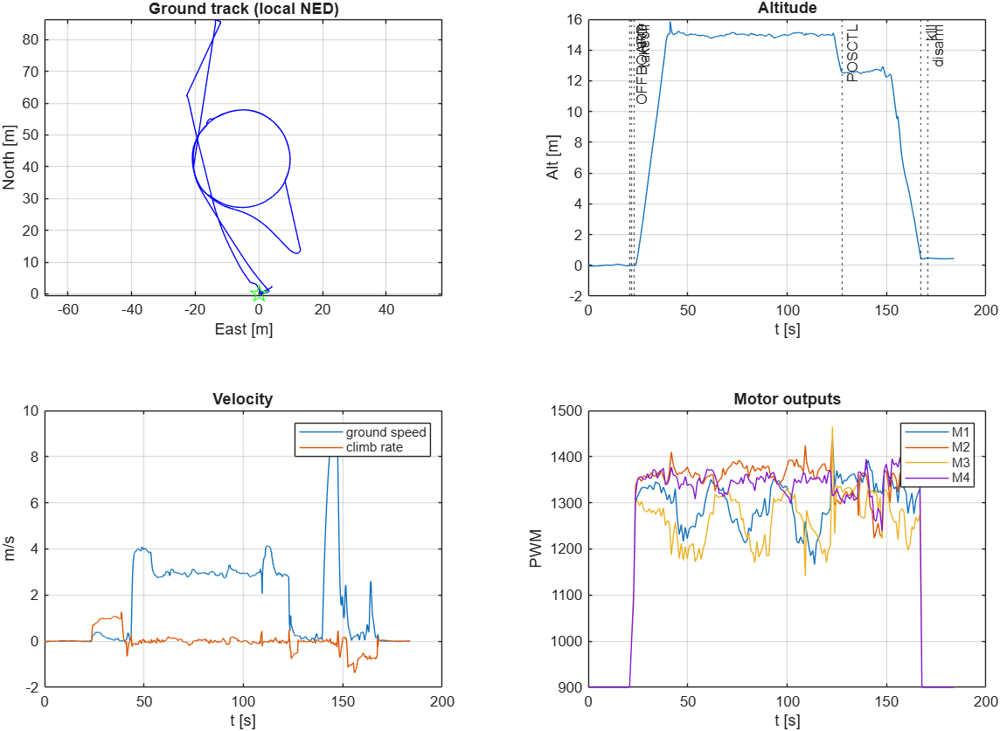
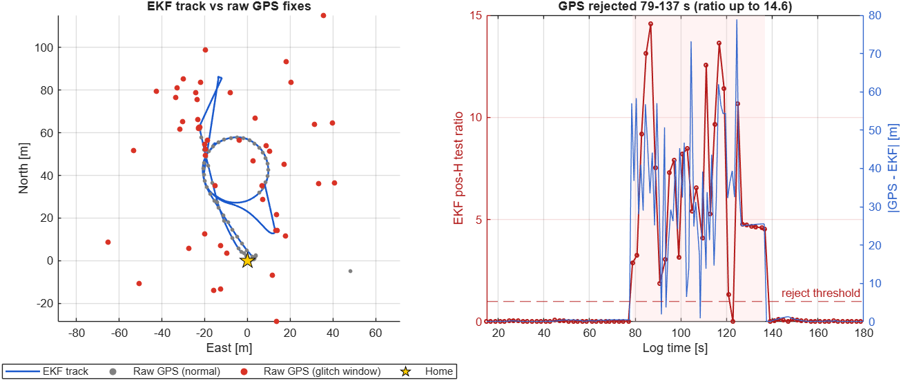
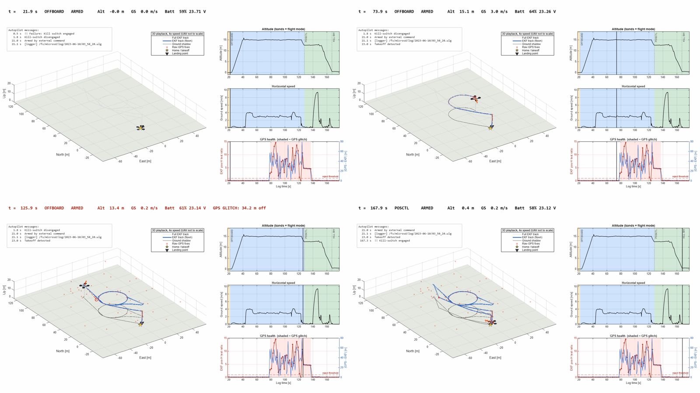

# Demo 1: UAV Flight Log Analysis

## Objective

Give the agent a raw PX4 MAVLink telemetry log (`.tlog`) and ask it, in plain language, what happened to the UAV. The agent writes and runs MATLAB itself through the MATLAB MCP Server and UAV Toolbox, and leaves outputs an engineer can review:

1. **Log analysis**: reconstruct the flight timeline (arming, flight modes, takeoff, landing), check vehicle health (track, speed, battery, GPS, estimator, vibration, motors) and flag anomalies. Here it finds a **GPS glitch from 79 to 137 s**: the EKF horizontal-position test ratio reaches **14.6** and the EKF rejects GPS
2. **Playback**: replay the flight in 3D at **4× speed** with synchronized telemetry panels, exported as an MP4

  

## Prompts used

| # | Prompt | Key verified result |
|---|---|---|
| 0 | *Checking if MATLAB MCP available?* | Pre-check: MATLAB R2026a Update 4 connected |
| 1 | *(attach `Sample_Log.tlog`)* *Please help me analyze this log: what happened to the UAV, as an overview? You can use MATLAB MCP and UAV Toolbox capabilities to analyze this log.* | 184 s log, 15,068 messages. OFFBOARD mission, GPS glitch 79–137 s (EKF ratio up to 14.6), pilot takeover in POSCTL at 127.7 s, kill-switch landing at 167.3 s, no crash |
| 2 | *Could you create the playback animation for us?* then *…increase the speed playback x4* | `Sample_Log_playback.mp4`: 4× speed, 1,201 frames, 40 s at 1600×900 |

A condensed transcript is in [`outputs/flight_log_analysis_conversation.md`](outputs/flight_log_analysis_conversation.md).

---

## Stage 1 · Log analysis

The agent opens the log with UAV Toolbox, reads each message type, decodes the PX4 flight modes and status text into a timeline, and checks the vehicle's health. [`work/analyze_sample_log.m`](work/analyze_sample_log.m) reproduces the same analysis in one run.

| Time (s) | Event |
|---|---|
| 0.5 | "Failure: Kill switch engaged" on the ground (pre-flight) |
| 21.0 | Armed by an external command (not by the ground station) |
| 21.7 / 23.0 | OFFBOARD mode, takeoff; climbs to about 15.5 m |
| 45–127 | OFFBOARD flight on velocity setpoints, up to about 87 m from home, top ground speed 9.4 m/s |
| **79–137** | **GPS glitch: raw GPS jumps tens of metres while still reporting a 3D fix with 19–20 satellites** |
| 127.7 | POSCTL: the pilot takes over and flies back near home |
| 167.3 | Kill switch engaged at about 1 m altitude; motors cut |
| 168.7 / 170.7 | Landing detected, disarmed by landing |

**The anomaly.** The EKF horizontal-position test ratio goes above 1 (up to 14.6), so the estimator rejects GPS and flies on the IMU. The estimated track stays smooth while the raw fixes scatter, and the EKF re-aligns to GPS at about 130–138 s.

Healthy: vibration near zero with no clipping, EKF velocity/vertical ratios ≤ 0.14, RC link solid, motor outputs balanced, battery 60 % → 48 % (23.7 → 23.3 V). Peak current reads only 1.4 A, which points to an uncalibrated current sensor or a simulation/test-rig log.

**Key functions**

| Function | Used for |
|---|---|
| `mavlinkdialect("ardupilotmega.xml", 2)` | MAVLink message definitions |
| `mavlinktlog` | Opens the `.tlog`; `AvailableTopics` lists the 35 message types present |
| `readmsg` | Reads one message type per call. Returns MAVLink v1 and v2 rows as separate tables, which the agent merges |
| `bitand` / `bitshift` | Decodes arming (`base_mode`) and the PX4 main mode (`custom_mode`, bits 16–23) |
| `exportgraphics` | Saves the figures |

Messages read: `HEARTBEAT`, `STATUSTEXT`, `EXTENDED_SYS_STATE`, `LOCAL_POSITION_NED`, `GLOBAL_POSITION_INT`, `GPS_RAW_INT`, `ESTIMATOR_STATUS`, `SYS_STATUS`, `VIBRATION`, `SERVO_OUTPUT_RAW`, `COMMAND_LONG`/`COMMAND_ACK`.

## Stage 2 · Playback

[`work/create_sample_log_playback.m`](work/create_sample_log_playback.m) replays the flight in 3D: the EKF track, a multirotor mesh posed with the logged attitude, raw GPS fixes, and home and landing points. Altitude, ground-speed and GPS-health panels follow a moving cursor, with flight-mode colour bands. The banner shows time, mode, arm state, altitude, speed and battery, and turns red with the GPS error during the glitch.

*Frames at log time ≈ 22, 74, 126 and 168 s: after arming, the OFFBOARD loop, the GPS glitch (red banner, scattered raw fixes) and the kill-switch landing.*

The agent first renders one preview frame, checks it and fixes the layout. The full 1,201-frame render takes about 8 minutes, longer than one MCP request, so it runs in a separate `matlab -batch` process with a hidden figure.

**Key functions**

| Function | Used for |
|---|---|
| `stlread` (`multirotor.stl`) | UAV mesh shipped with UAV Toolbox |
| `hgtransform`, `eul2rotm` | Poses the mesh from the logged yaw/pitch/roll (NED → ENU) |
| `plot3`, `scatter3`, `xregion` | Track, raw GPS fixes, glitch window |
| `print -RGBImage` | Captures each frame from the hidden figure |
| `VideoWriter` (MPEG-4), `writeVideo` | Writes the MP4 |

---

## Requirements and dependencies

| Item | Used for |
|---|---|
| MATLAB R2026a Update 4 | Runtime (earlier run used R2025b, see `outputs/obsolete/`) |
| UAV Toolbox | `mavlinkdialect`, `mavlinktlog`, `readmsg`, `multirotor.stl` mesh |
| MATLAB (base) | `VideoWriter` and 3D graphics for the playback |
| MATLAB MCP Server | Lets the agent run MATLAB code and scripts |

No Simulink model is used in this demo.

## Skills used

- **No custom skill.** The agent works directly from the MATLAB MCP tools and UAV Toolbox.
- Optional deeper follow-up: analyze the referenced PX4 ULOG (`03_50_20.ulg`) with `ulogreader` for EKF innovations, failsafe flags and actuator outputs.

## Files

| File | Description |
|---|---|
| `outputs/Sample_Log.tlog` | Input telemetry log (PX4 quadrotor, 184 s) |
| `work/analyze_sample_log.m` | Stage 1: timeline, health summary, figures, CSV and MAT |
| `work/create_sample_log_playback.m` | Stage 2: playback video, preview frame |
| `outputs/Sample_Log_overview.png` | Ground track, altitude with events, velocity, motor outputs |
| `outputs/Sample_Log_gps_glitch.png` | EKF track vs raw GPS, EKF test ratio and GPS error |
| `outputs/Sample_Log_timeline.csv` | Flight events with time stamps |
| `outputs/Sample_Log_analysis_results.mat` | `summary` struct, `timeline` table and key time series (`series`) |
| `outputs/Sample_Log_playback.mp4` | Playback video, 4× speed, 40 s (not tracked in git: `*.mp4` is ignored) |
| `outputs/Sample_Log_playback_preview.png` | Playback frame at t = 110 s |
| `outputs/Sample_Log_playback_frames.png` | Four playback frames |
| `outputs/flight_log_analysis_conversation.md` | Condensed prompt and response transcript |
| `outputs/obsolete/` | Previous run (R2025b): `create_uav_playback.m`, its preview, video and transcript |

> Both scripts resolve paths relative to their own location, so you can run them from anywhere. `analyze_sample_log.m` takes about 10 s. `create_sample_log_playback.m` takes about 8 minutes; for a quick check, set `previewOnly = true` in the workspace before running it to render only the preview frame.
