# Demo 2: Guidance Model → Waypoint Follower → 3D UAV Scenario

## Objective

Build a UAV simulation in stages through conversation with the agent. Each stage is its own Simulink model, so every new capability can be compared against the stage before it, and the agent verifies each stage with numbers before moving on:

1. **Step response**: reduced-order multirotor Guidance Model (NED), one step per control input, command vs. response
2. **Waypoint following**: Waypoint Follower + position/yaw controller close the loop on a 20 m square at 5 m altitude, shown with UAV Animation
3. **Scene + lidar**: the same mission inside a UAV Scenario with a 10 m building on the path, a lidar and the Scenario Scope. This shows that *waypoint completion ≠ collision-free* and prepares the obstacle-avoidance stage

  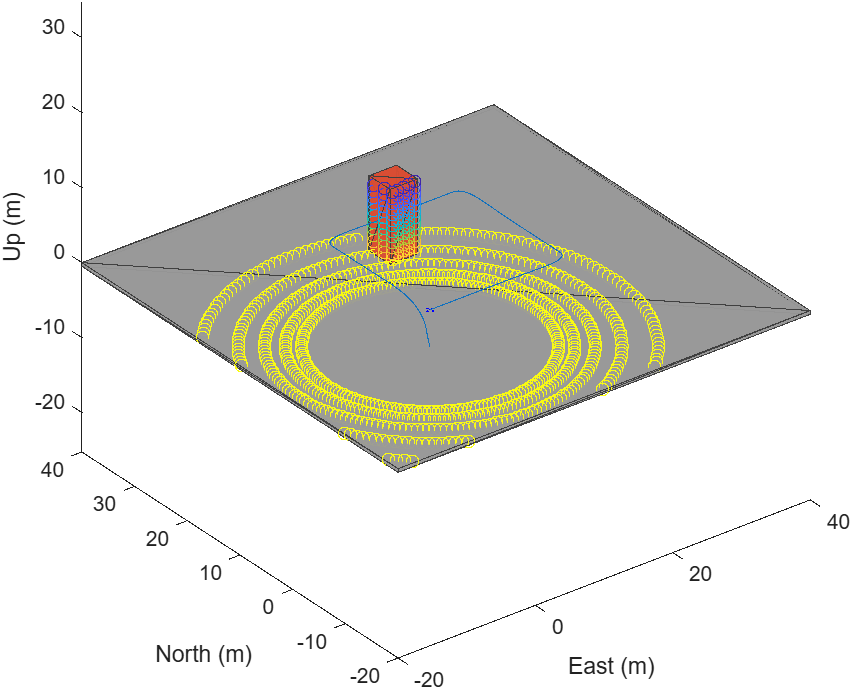

## Prompts used

| # | Prompt | Key verified result |
|---|---|---|
| 1 | *Could you please check if MATLAB MCP available and which version is open* | MATLAB R2026a Update 4, MCP connected |
| 2 | `/matlab-uav-simulink-blocks` *Check if you can access to this skill?* | Skill and its 6 references found; companion skills available |
| 3 | `/matlab-uav-simulink-blocks` *Could you help me create a simple UAV multirotor guidance model and simulate the step response for each control input?* | Roll/pitch 0.1 rad: rise 0.058 s, settle 0.10 s. Yaw rate 0.5 rad/s: rise 0.001 s. Thrust +0.1 N: rise 0.0006 s. 0 % overshoot, hover baseline holds still |
| 4 | *Could you please show the plot compare to the input also?* | Command (dashed) overlaid on response, with a zoomed row around the step |
| 5 | *Please continue to develop "UAV_GuidanceStepResponse". I would like to add a waypoint follower to this guidance model and simulate the UAV following a simple waypoint path. You can visualize it using the UAV Animation block.* | Status = 1 at 34.9 s, final error 0.000 m, hover at the end, flown path within 0.47 m of the plan |
| 6 | `/matlab-uav-simulink-blocks` *Now I would like to put this guidance model and waypoints into a scene with the UAV Scenario block. Could you make a simple one that obstruct between the flight path.?* | Status = 1, **but** minimum clearance −2.0 m: the UAV flies through the building from 13.8 s to 15.9 s. Lidar 3600 × 3 per frame |
| 7 | *Line signal in UAV_GuidanceWaypointScenario is very messy. Could you please help me group or rearrange the model … layout model start from Waypoint → Control → Guidance model → Scenario?* | Left-to-right flow; `[State]` Goto/From replaces long feedback lines |
| 8 | *I think should expand the subsystem but keep the signal line neat.* / *Could you arrange the block to be more closer so it will less wide* / *apply the same principle to "UAV_GuidanceWaypointFollowing"* | Flat models with coloured, labelled area groups, about 35 % narrower; mission results unchanged after every re-layout |

`/matlab-uav-simulink-blocks` explicitly invokes the custom skill.

---

## Stage 1 · Step response

Open-loop test of the reduced-order multirotor plant, starting from hover. One input steps at t = 1 s while the others stay at trim (thrust steps around hover, m·g = 0.981 N).

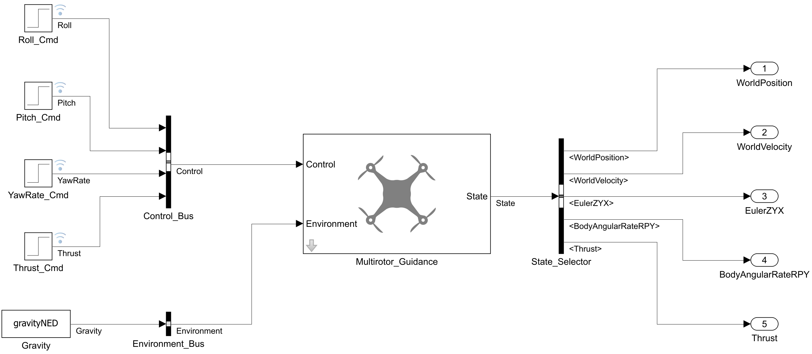

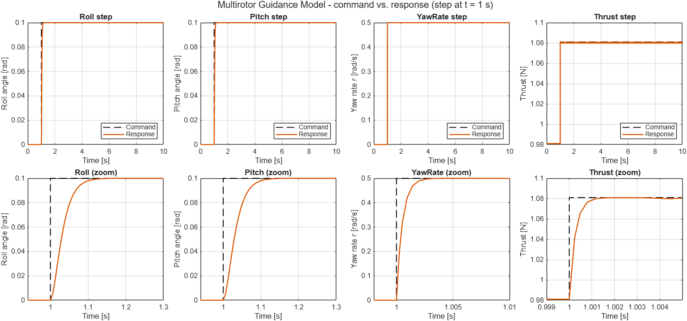

| Input | Step | Final value | Rise time | Overshoot |
|---|---|---|---|---|
| Roll | 0.1 rad | 0.1000 rad | 0.058 s | 0 % |
| Pitch | 0.1 rad | 0.1000 rad | 0.058 s | 0 % |
| Yaw rate | 0.5 rad/s | 0.4997 rad/s | 0.001 s | 0 % |
| Thrust | +0.1 N | 1.0809 N | 0.0006 s | 0 % |

**Key block: Guidance Model**

| | |
|---|---|
| 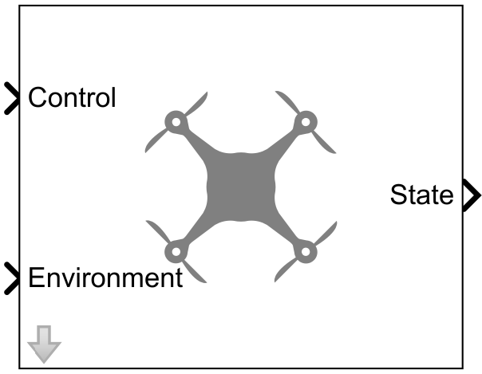 | Reduced-order, closed-loop UAV model: takes autopilot-level commands and returns the vehicle state, so guidance and missions simulate fast. • Multirotor or fixed-wing model type • In: roll, pitch, yaw rate, thrust (+ gravity) • Out: NED position, velocity, Euler ZYX, body rates, thrust • Tunable mass, gains and initial state |

## Stage 2 · Waypoint following

Closed loop: the Waypoint Follower feeds a position/yaw controller (MATLAB Function), which commands the same Guidance Model. Mission: take off, climb to 5 m, fly a 20 m square and return.

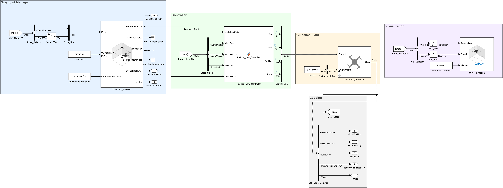

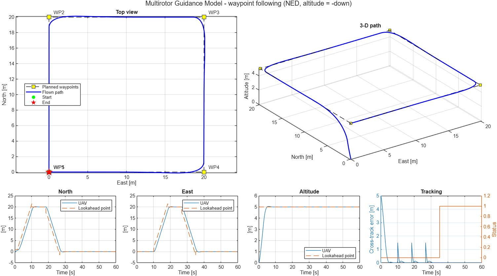 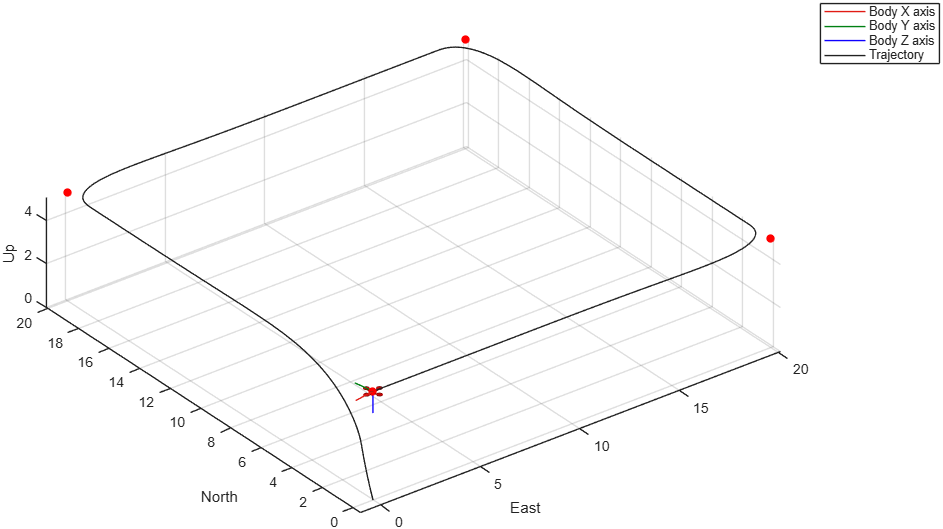

Status = 1 at 34.9 s · final error 0.000 m · final speed 0 (hover) · max distance from planned path after take-off 0.465 m · max horizontal speed 2.4 m/s.

**Key blocks**

| | |
|---|---|
| 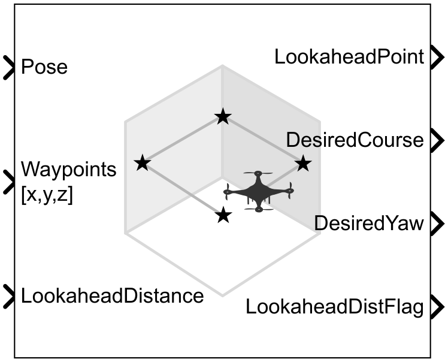 | **Waypoint Follower**: tracks a waypoint list by chasing a lookahead point on the path. • Out: lookahead point, desired course and yaw • Optional cross-track error and mission status • Transition radius, hover at last waypoint |
| 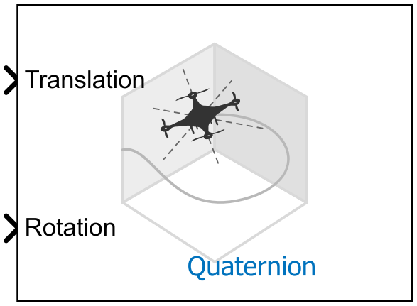 | **UAV Animation**: lightweight 3-D view of UAV position and attitude while it runs. • Rotation as quaternion or Euler ZYX • NED or ENU axes, multiple UAVs • Waypoint markers; no scene or meshes needed |

## Stage 3 · Scene + lidar

The same mission inside a UAV Scenario, with a 4 × 4 × 10 m building on the WP2 → WP3 leg. No avoidance yet: this is the baseline for the obstacle-avoidance stage.

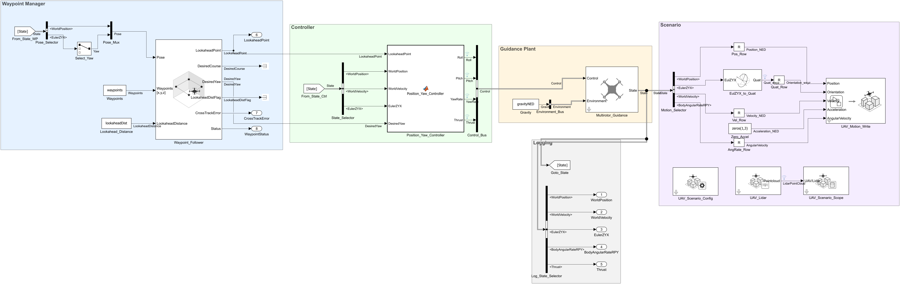

 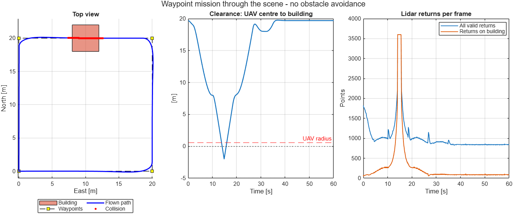

Status = 1 at 34.9 s and final error 0.000 m, **but** minimum clearance −2.0 m: the UAV body intersects the building from 13.8 s to 15.9 s. Lidar returns 3600 × 3 points per frame (601 frames) and sees the building in every frame.

**Key blocks: UAV Scenario family**

Run a `uavScenario` (meshes, platforms, sensors) with the model. Configuration loads the scene; the others move platforms, read motion, simulate sensors and visualize it. **Bold** = used in this model.

| **Configuration** | **Motion Write** | Motion Read |
|:---:|:---:|:---:|
| 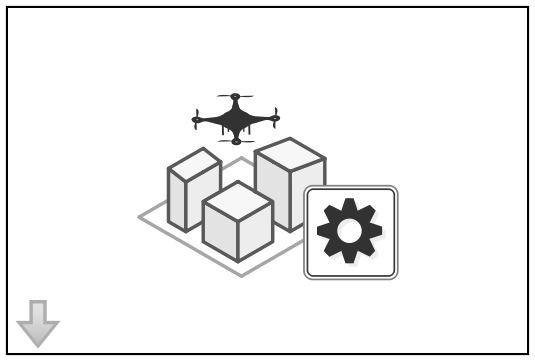 | 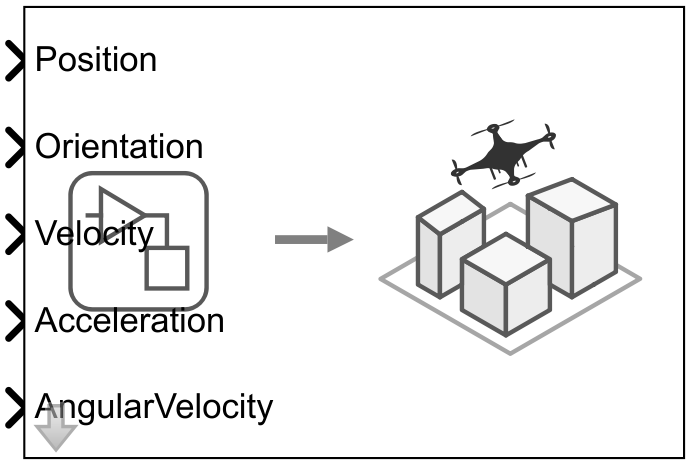 | 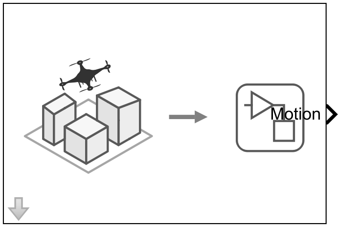 |
| **Lidar** | Get Transform | **Scope** |
| 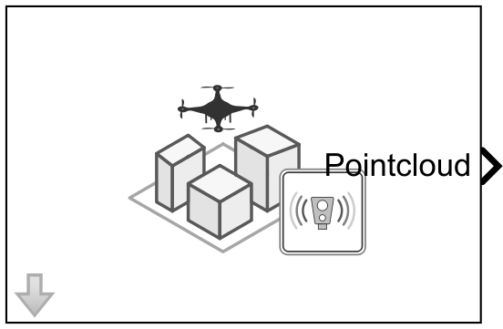 | 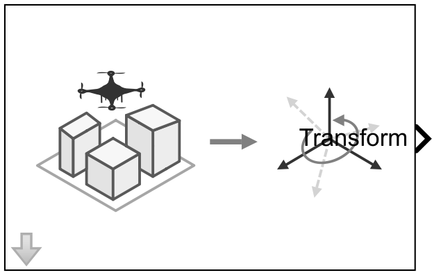 | 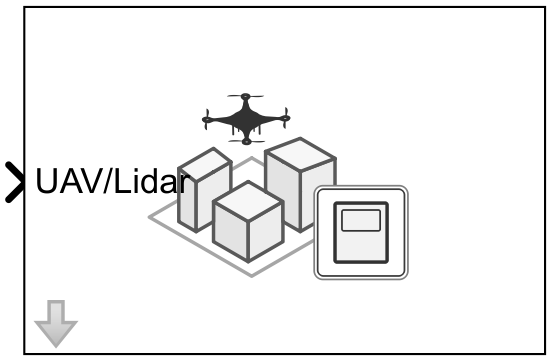 |

---

## Requirements and dependencies

| Item | Used for |
|---|---|
| MATLAB R2026a Update 4 + Simulink | Model build and simulation (`Simulink.SimulationInput`, `sim`) |
| UAV Toolbox | Guidance Model, Waypoint Follower, UAV Animation, Coordinate Transformation Conversion, UAV Scenario Configuration / Motion Write / Lidar / Scope, `uavScenario`, `uavPlatform`, `uavLidarPointCloudGenerator` |
| Control System Toolbox | `stepinfo` (rise and settling time) |
| MATLAB MCP Server Toolbox 0.4.0 | MATLAB execution and the Simulink model tools (`model_read`, `model_edit`, `model_check`) |
| C compiler (`mex -setup`) | Stages 2–3 run the Guidance Model and Waypoint Follower in *Code generation* mode (about 8 s per 60 s mission instead of minutes) |
| AI agent host | Claude Code (desktop app) for this refresh |

## Skills used

| Skill | Role |
|---|---|
| **`matlab-uav-simulink-blocks`** (custom, see [`../Skill-unique`](../Skill-unique/)) | Block-level contracts for UAV blocks: NED frames, `[yaw pitch roll]` order, `[w x y z]` quaternions, staged visualization (Animation first, Scenario only when needed), acceptance checks per recipe |
| `building-simulink-models` | Required companion for every structural or parameter edit |
| `simulating-simulink-models` | Runs with parameter overrides and result retrieval |

## Files (`outputs/`)

| File | Description |
|---|---|
| `UAV_GuidanceStepResponse.slx` | Stage 1 model: Step × 4 → Control bus → Guidance Model |
| `run_guidance_step_responses.m` | Stage 1 runner → `stage1_step_responses.png`, `stage1_step_results.mat`, `stage1_step_summary.csv` |
| `UAV_GuidanceWaypointFollowing.slx` | Stage 2 model: Waypoint Manager → Controller → Guidance Plant → Visualization |
| `run_waypoint_mission.m` | Stage 2 runner → `stage2_waypoint_following_results.png`, `stage2_waypoint_results.mat`, `stage2_waypoint_summary.csv` |
| `Position_Yaw_Controller_code.m` | Readable copy of the controller code inside the MATLAB Function block (the block holds the live code) |
| `UAV_GuidanceWaypointScenario.slx` | Stage 3 model: Waypoint Manager → Controller → Guidance Plant → Scenario |
| `setup_uav_scenario.m` | Builds the scene (ground, building, UAV platform, lidar). Called by the model's `PreLoadFcn` and `InitFcn` |
| `run_scenario_mission.m` | Stage 3 runner → `stage3_scenario_clearance_results.png`, `stage3_scenario_scope.png`, `stage3_scenario_results.mat`, `stage3_scenario_summary.csv` |
| `stage*_model_*.png`, `block_icons/` | Model diagrams and block icons used in this README and the slides |
| `obsolete/` | Previous version of this demo (single `uav_multirotor_step_response.slx` with modes, R2025b run) |

`.mat` files store signals resampled to 0.05 s; Stage 3 stores lidar as per-frame counts rather than full point clouds, to keep the files small.

## Notes

- **Long clone paths on Windows:** code-generation builds can exceed the 260-character path limit. The runner scripts move the Simulink cache and code-generation folder to `tempdir` when their own path is long.
- **Scenario model load order:** the UAV Scenario blocks need `uavScene` to exist when the model loads, so `setup_uav_scenario` runs in `PreLoadFcn` as well as `InitFcn` (which rebuilds the handle object before every run).

## Next step

Add reactive **obstacle avoidance** (Scenario Lidar → Obstacle Avoidance block, recipe D in the skill). Run it against the same scene and mission, keep `UAV_GuidanceWaypointScenario.slx` as the baseline, and report minimum clearance separately from mission completion.
