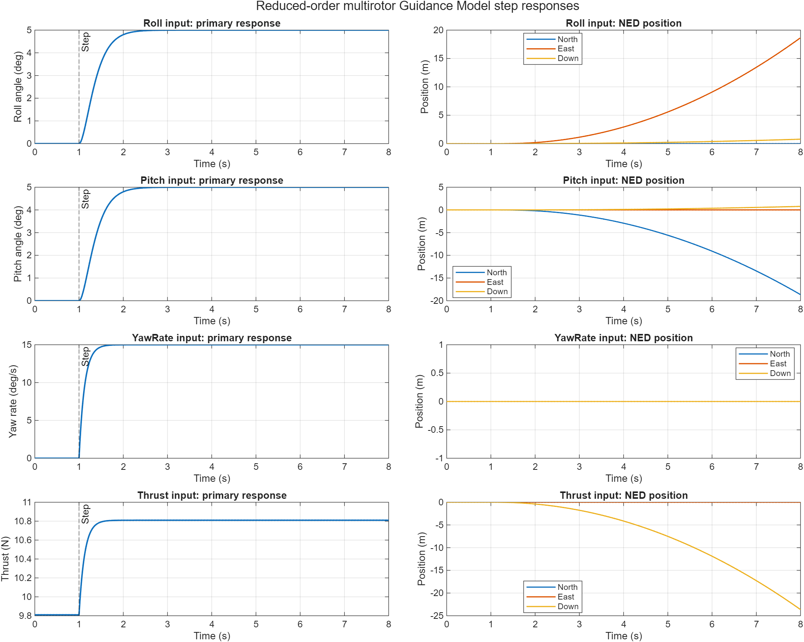
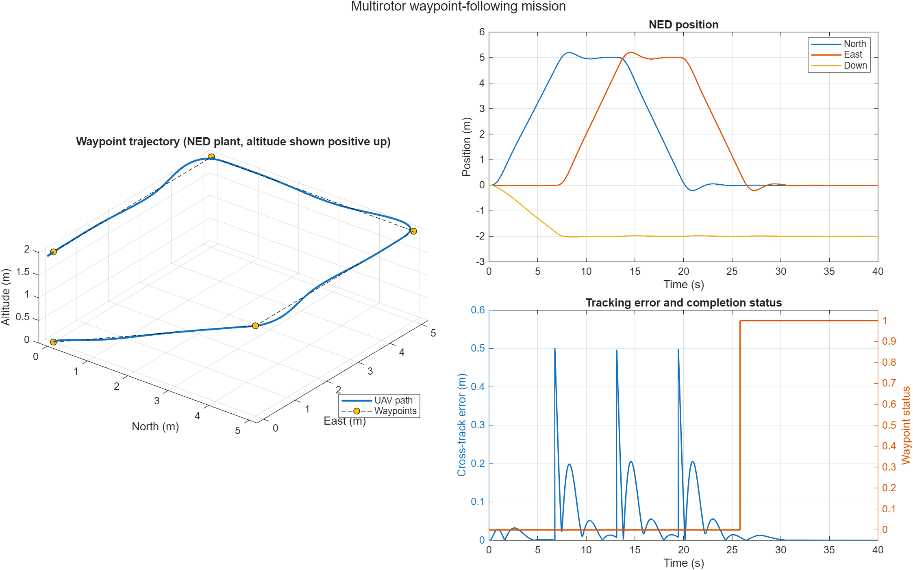
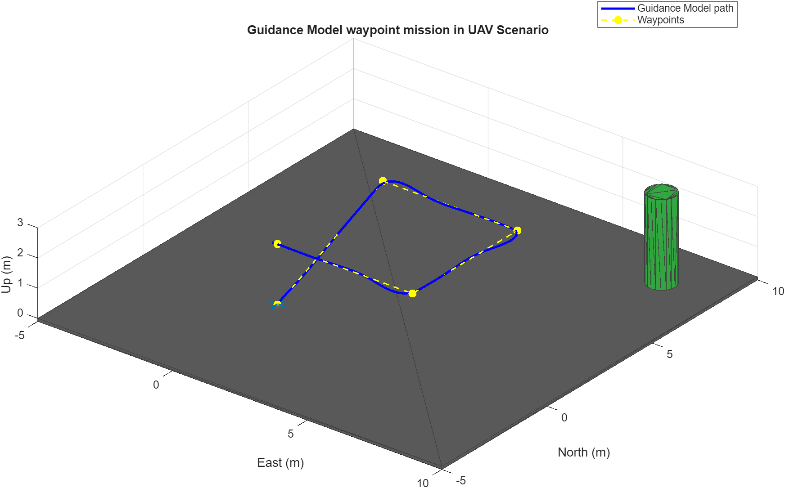
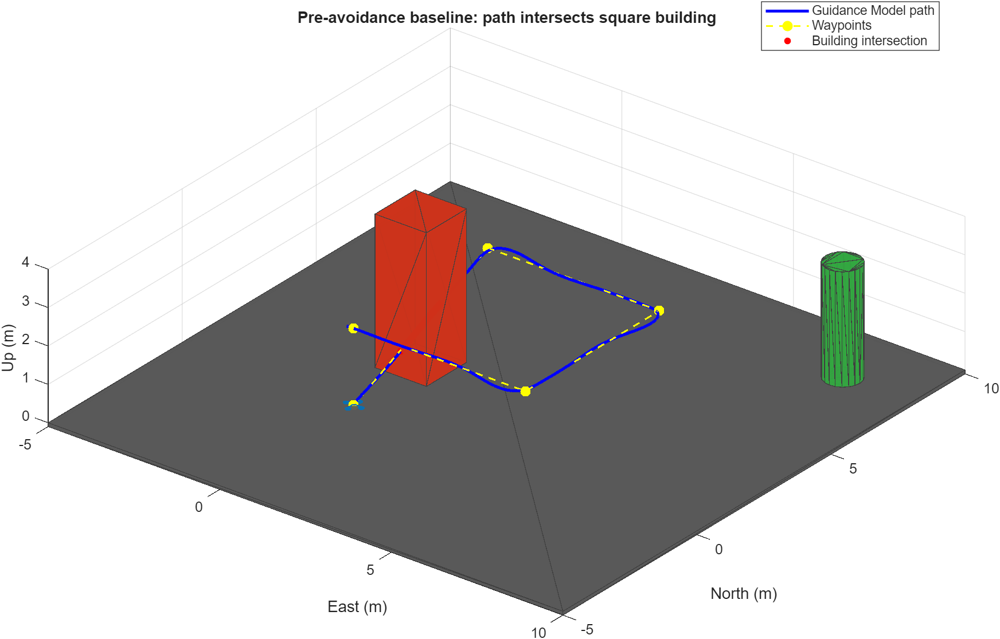

# Guidance/Waypoint/3Dscenario — Conversation Transcript

This transcript preserves the user prompts and the assistant's final responses verbatim, in chronological order. System/developer instructions, internal reasoning, tool calls, tool outputs, and progress commentary are omitted.

## Exchange 1

### User prompt

Could you help me check if MATLAB MCP is available

### Assistant response

Yes—MATLAB MCP is available and responding successfully.

- MATLAB: R2025b Update 5
- MATLAB MCP Server Toolbox: version 0.4.0
- Simulink and numerous other toolboxes are accessible

I can use it to execute MATLAB code, inspect toolboxes, analyze scripts, run tests, and work with Simulink models.

## Exchange 2

### User prompt

[$matlab-uav-simulink-blocks](../../Skill-unique/matlab-uav-simulink-blocks/SKILL.md) Could you help me create simple UAV multirotor guidance model and simulate the step response form each control input?

### Assistant response

Created and verified the reduced-order UAV multirotor Guidance Model. It uses NED coordinates and independently simulates roll, pitch, yaw-rate, and thrust-about-hover inputs, following the official [MathWorks Guidance Model interface](https://www.mathworks.com/help/releases/R2025b/uav/ref/guidancemodel.html).

| Input step | Final response | Rise time | Settling time |
|---|---:|---:|---:|
| Roll: 5° | 5° | 0.672 s | 2.167 s |
| Pitch: 5° | 5° | 0.672 s | 2.167 s |
| Yaw rate: 15°/s | 15°/s | 0.275 s | 1.489 s |
| Thrust: +1 N from hover | 10.81 N | 0.275 s | 1.489 s |

All four 8-second simulations completed successfully, with zero overshoot. The model also passed Simulink connectivity checks.

Deliverables:

- [Simulink model](<uav_multirotor_step_response.slx>)
- [Reproducible MATLAB runner](<run_uav_multirotor_steps.m>)
- [Response summary CSV](<uav_multirotor_step_summary.csv>)
- [Complete MATLAB results](<uav_multirotor_step_results.mat>)

## Exchange 3

### User prompt

Please continue to develop with "uav_multirotor_step_response". I would like to add waypoint follower to this guidance model and simulate the UAV to follow the simple waypoint. 
You can try to visualize it using UAV animation block for this simple visulization.

### Assistant response

Extended `uav_multirotor_step_response` with waypoint navigation and UAV Animation while preserving the original step-response mode.

Mission results:

- Waypoint status: `1` — completed
- Completion time: 25.81 s
- Final position error: 0.000071 m
- Maximum cross-track error: 0.5003 m
- Final hover speed: 0.000031 m/s
- Structural connectivity check: healthy

The demonstration follows a 5 m square while climbing to 2 m altitude. Waypoint yaw is held at zero because this baseline controller uses a small-angle acceleration mapping referenced to zero yaw. The UAV Animation block uses NED translation, `[yaw pitch roll]`, waypoint markers, and a 0.2-second update interval, consistent with the official [Waypoint Follower](https://www.mathworks.com/help/releases/R2025b/uav/ref/waypointfollower.html) and [UAV Animation](https://www.mathworks.com/help/releases/R2025b/uav/ref/uavanimation.html) interfaces.

Files:

- [Enhanced Simulink model](<uav_multirotor_step_response.slx>)
- [Waypoint simulation script](<run_uav_waypoint_mission.m>)
- [Mission summary CSV](<uav_waypoint_mission_summary.csv>)
- [Complete mission results](<uav_waypoint_mission_results.mat>)

## Exchange 4

### User prompt

[$matlab-uav-simulink-blocks](../../Skill-unique/matlab-uav-simulink-blocks/SKILL.md) Now I would like to put this guidance model and this waypoint to the scene in UAV scenario block.. Could you do it for me a simple one?

### Assistant response

Added a simple UAV Scenario to the existing model and simulated it successfully.

The scenario contains:

- One Guidance Model-driven multirotor platform
- Ground plane
- Decorative cylinder outside the waypoint path
- NED position and velocity inputs
- `EulerZYX` converted to scalar-first `[w x y z]` quaternion
- Scenario Configuration → Motion Write → Scenario Scope execution order
- Previous UAV Animation retained but disabled by default

Mission verification:

- Waypoint status: `1`
- Completion time: 25.81 s
- Final position error: 0.000071 m
- Maximum cross-track error: 0.5003 m
- Final hover speed: 0.000031 m/s

The setup follows the official [UAV Scenario Configuration](https://www.mathworks.com/help/uav/ref/uavscenarioconfiguration.html) and [Motion Write](https://www.mathworks.com/help/uav/ref/uavscenariomotionwrite.html) interfaces. The runner recreates the handle-based scenario before every simulation.

Files:

- [Updated Simulink model](<uav_multirotor_step_response.slx>)
- [Scenario creation function](<create_simple_uav_scenario.m>)
- [Scenario mission runner](<run_uav_scenario_mission.m>)
- [Mission summary](<uav_scenario_mission_summary.csv>)
- [Complete results](<uav_scenario_mission_results.mat>)

## Exchange 5

### User prompt

Could you try adding square building to obstract between the flight path? Later we can use it for implementing the obstarcle avoidance.

### Assistant response

Added a separate obstructed-scene variant while preserving the original clear-scene baseline.

The square building:

- East bounds: `[-0.75, 0.75]` m
- North bounds: `[1.75, 3.25]` m
- Height: `0–4` m
- Positioned directly across the first waypoint segment

Baseline result:

- Waypoint mission still reports completion: `1`
- Path intersects building: `true`
- Minimum point clearance: `0 m`
- Completion time: 25.81 s

This demonstrates why waypoint completion alone is not a safety measure—the Scenario blocks visualize motion but do not impose collision physics.

Files:

- [Obstructed scenario creator](<create_obstructed_uav_scenario.m>)
- [Pre-avoidance simulation](<run_uav_scenario_obstructed_mission.m>)
- [Summary CSV](<uav_scenario_obstructed_summary.csv>)
- [Complete results](<uav_scenario_obstructed_results.mat>)

