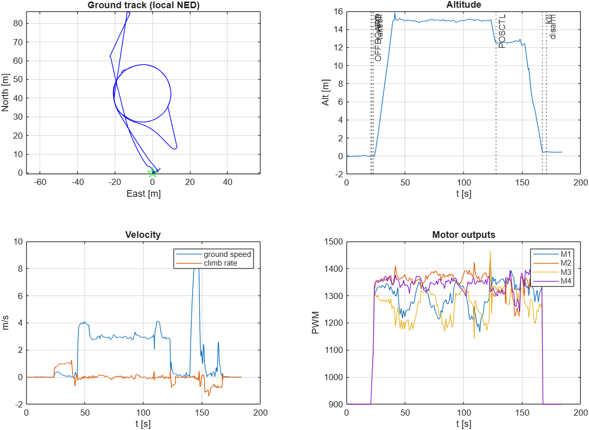
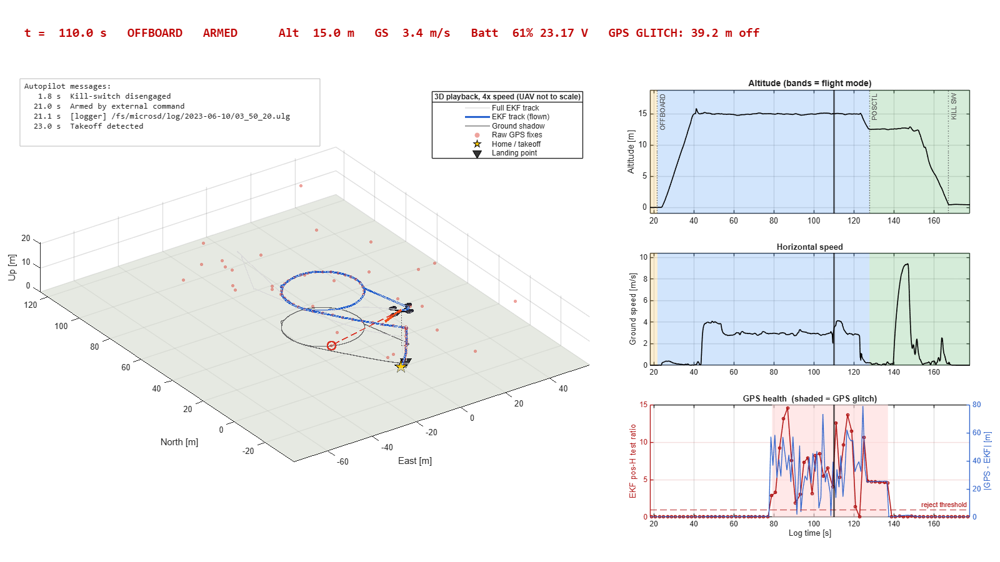
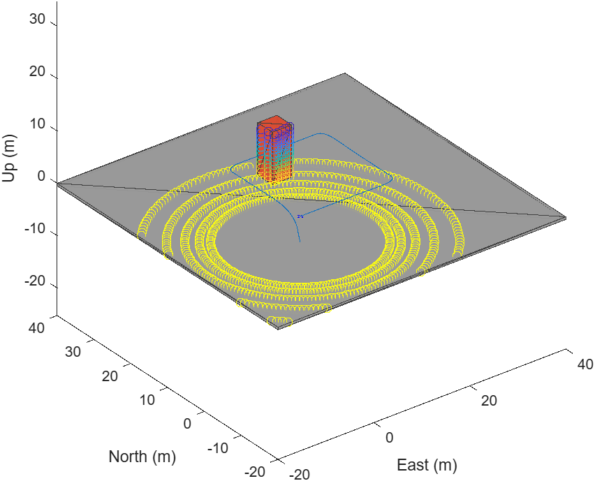
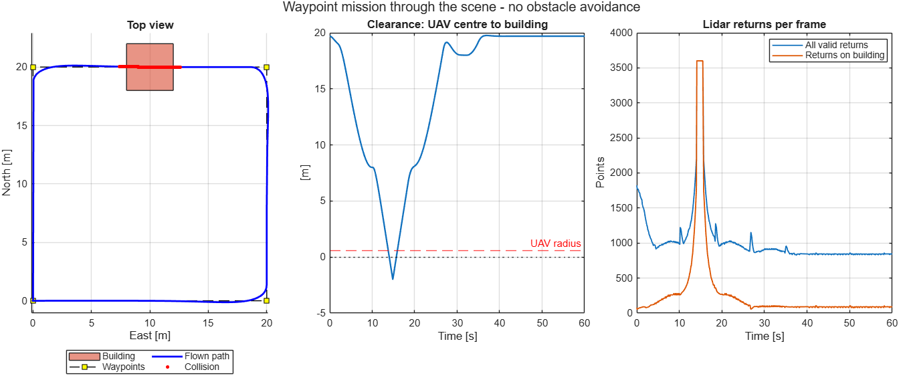
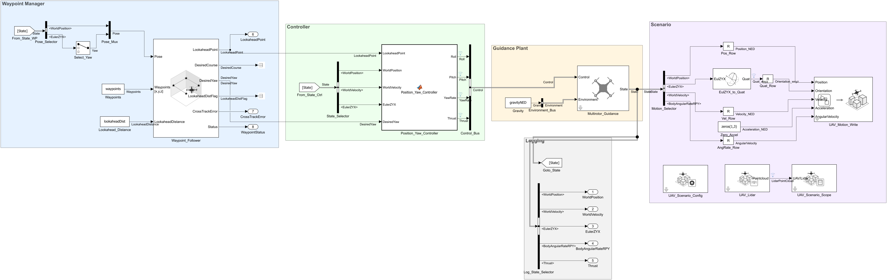

# UAV Development with Agentic AI + MATLAB MCP

Two short demos where an AI coding agent drives MATLAB and Simulink through the **MATLAB MCP Server**. Engineers describe what they want in plain language. The agent then builds the model, runs it, and reports back verified numbers.

> 🎬 **Reference video:** [Agentic AI with UAV - Live demo prompt.mp4](https://techsource-my.sharepoint.com/:v:/g/personal/pattarapol_ascendas-asia_com/IQBRsCB0G0JHRJRRCPEJMq9nAUpRST41OJ9GNdEiidxSVWQ?nav=eyJyZWZlcnJhbEluZm8iOnsicmVmZXJyYWxBcHAiOiJPbmVEcml2ZUZvckJ1c2luZXNzIiwicmVmZXJyYWxBcHBQbGF0Zm9ybSI6IldlYiIsInJlZmVycmFsTW9kZSI6InZpZXciLCJyZWZlcnJhbFZpZXciOiJNeUZpbGVzTGlua0NvcHkifX0&e=LTaROp). This recording walks through the live prompts for both demos. Watch it alongside the prompt tables in each demo folder.

| Demo | Folder | What it shows |
|---|---|---|
| 1. Flight log analysis | [`Flight-Log-Analysis/`](Flight-Log-Analysis/) | Read a real PX4 MAVLink `.tlog`, get a flight overview and anomaly diagnosis, then produce a playback video |
| 2. Guidance → Waypoint → 3D Scenario | [`Guidance-Waypoint-3DScenario/`](Guidance-Waypoint-3DScenario/) | Build a multirotor Guidance Model in three stages: step response, waypoint following with UAV Animation, then the same mission in a UAV Scenario with a building and lidar on the path |

Supporting material:

- [`Skill-unique/`](Skill-unique/): a custom agent skill (`matlab-uav-simulink-blocks`) used in Demo 2. **Recommended to install** before running the demo.
- `UAV_Agentic_AI_Workflow_Writeup.docx`: the customer-facing write-up (challenges, objectives, workflow).

---

## Objective

Show that one repeatable, agent-assisted workflow can connect the UAV development loop from start to finish:

1. **Create** a simple guidance model for navigation experiments
2. **Add** path-following logic (waypoint follower)
3. **Simulate** the UAV in a 3D scenario with obstacle geometry
4. **Log and analyze** flight behavior (simulated or real flight logs)

The point is not that "AI writes code". The agent works inside the real MATLAB/Simulink session, checks its own results (step-response metrics, waypoint status, clearance, model checks) and keeps every artifact so engineers can reproduce it.

---

## Latest result: Demo 1 (Flight log analysis)

The agent reads a real PX4 telemetry log (`Sample_Log.tlog`, 184 s, 15,068 MAVLink messages) with UAV Toolbox and explains the flight: an OFFBOARD mission, a GPS glitch, a pilot takeover in Position mode, and a landing finished with the kill switch. It then replays the flight in 3D at 4× speed.

<p align="center">
  
  
</p>

| Check | Result |
|---|---|
| Flight timeline | Armed by external command at 21.0 s, OFFBOARD takeoff to ~15.5 m, POSCTL takeover at 127.7 s, disarmed by landing at 170.7 s |
| **GPS glitch** | **79–137 s: raw GPS jumps tens of metres while still reporting a 3D fix; EKF horizontal-position test ratio up to 14.6, so the EKF rejects GPS** |
| Landing | Kill switch engaged at ~1 m altitude (167.3 s); no crash in the data |
| Playback | 4× speed MP4, 40 s at 1600×900, with 3D view and synchronized telemetry panels |

The prompts, the GPS-glitch evidence and the playback frames are in [`Flight-Log-Analysis/README.md`](Flight-Log-Analysis/README.md).

---

## Latest result: Demo 2 (Guidance → Waypoint → 3D Scenario)

The multirotor Guidance Model, closed-loop with a Waypoint Follower, flies a 20 m square at 5 m altitude inside a UAV Scenario. A 10 m building sits on the second leg, and a lidar on the UAV sees it in every frame.

<p align="center">
  
  
</p>

| Check | Result |
|---|---|
| Waypoint status | Completed (status = 1) at 34.9 s, final position error 0.000 m |
| Lidar | 3600 × 3 point cloud per frame, building visible in all 601 frames |
| **Minimum clearance** | **−2.0 m: the UAV flies through the building from 13.8 s to 15.9 s** |

Mission completion is not the same as a collision-free flight. This model is the baseline for the next stage, lidar-based obstacle avoidance.

<p align="center">
  
</p>

All three stages (step response, waypoint following, scene + lidar), with prompts, model pictures and key blocks, are in [`Guidance-Waypoint-3DScenario/README.md`](Guidance-Waypoint-3DScenario/README.md).

---

## Requirements and dependencies

### Software (as used in the recorded sessions)

| Item | Version / note |
|---|---|
| MATLAB | R2026a Update 4 (both demos refreshed). The original recordings used R2025b Update 5 |
| Simulink | Required for Demo 2 |
| UAV Toolbox | Both demos (`mavlinktlog`, `mavlinkdialect`, Guidance Model, Waypoint Follower, UAV Animation, `uavScenario`, Scenario blocks) |
| Control System Toolbox | Demo 2 (`stepinfo` for rise/settling time) |
| MATLAB MCP Server Toolbox | 0.4.0. Exposes MATLAB execution and the Simulink model tools (`model_read`, `model_edit`, `model_check`, …) to the agent |
| AI agent host | Any MCP-capable coding agent. The recordings used OpenAI Codex; the refreshes of both demos used Claude Code |
| C compiler (`mex -setup`) | Demo 2 stages 2–3 run the Guidance Model and Waypoint Follower in *Code generation* mode |

### Agent skills

| Skill | Source | Used in |
|---|---|---|
| `matlab-uav-simulink-blocks` | **Custom**, in [`Skill-unique/`](Skill-unique/) | Demo 2 |
| `building-simulink-models` | MathWorks agentic skills (model-based design core) | Demo 2: required companion for every model edit |
| `simulating-simulink-models` | MathWorks agentic skills (model-based design core) | Demo 2: parameterized runs and result retrieval |
| *(none)* | MATLAB MCP + UAV Toolbox only | Demo 1 |

### Quick setup

1. Install MATLAB R2025b with Simulink, UAV Toolbox and Control System Toolbox.
2. Install and register the MATLAB MCP Server in your agent host.
3. Copy `Skill-unique/matlab-uav-simulink-blocks/` into your agent's skills folder (see [`Skill-unique/README.md`](Skill-unique/README.md)).
4. Open the agent and run the first prompt: *"Check if MATLAB MCP is available"*.

> **Note:** All scripts resolve paths relative to their own location (`fileparts(mfilename("fullpath"))`), so you can run them from any clone location without editing them.

---

## Repository layout

```text
Github-Checkout/
├── README.md                              ← this file
├── UAV_Agentic_AI_Workflow_Writeup.docx   ← customer-facing write-up
├── Flight-Log-Analysis/
│   ├── README.md
│   ├── outputs/   (Sample_Log.tlog, analysis .mat/.csv/.png, playback MP4 + frames, transcript)
│   │   └── obsolete/   (previous R2025b run of this demo)
│   └── work/      (analyze_sample_log.m, create_sample_log_playback.m)
├── Guidance-Waypoint-3DScenario/
│   ├── README.md
│   └── outputs/   (3 stage models, runner scripts, results .mat/.csv/.png, block_icons/)
│       └── obsolete/   (previous single-model version of this demo)
└── Skill-unique/
    ├── README.md
    └── matlab-uav-simulink-blocks/  (SKILL.md + references/)
```
